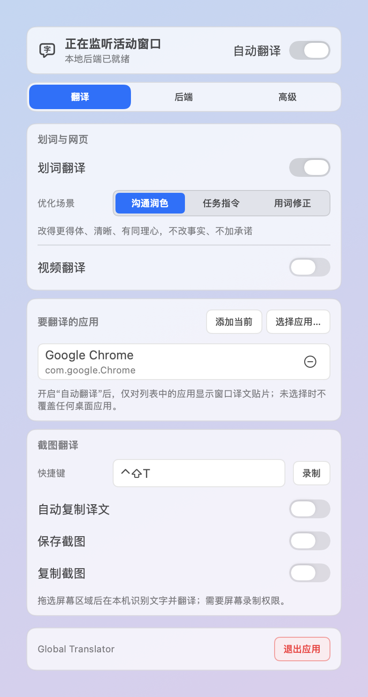
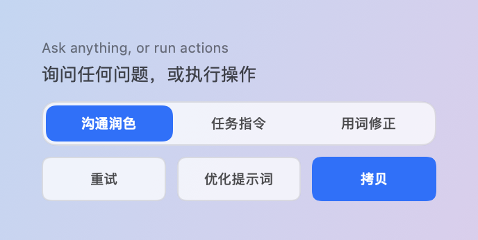
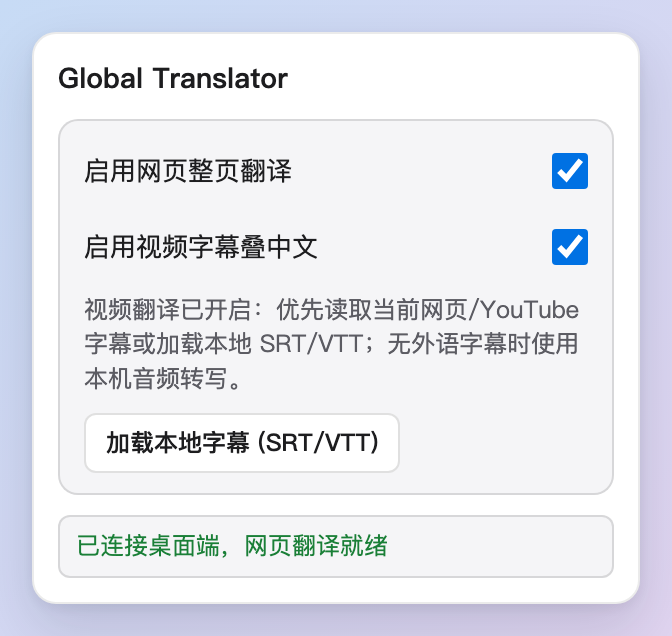

# Global Translator（全局翻译）

**简体中文** | [English](README_EN.md)

[](https://github.com/827748510-blip/global-translator)
[](https://github.com/827748510-blip/global-translator/stargazers)
[](LICENSE)
[](https://github.com/827748510-blip/global-translator)

> [!TIP]
> 如果 **Global Translator** 帮到了你，欢迎点击仓库右上角 **Star** 支持作者 **maodashu**：[github.com/827748510-blip/global-translator](https://github.com/827748510-blip/global-translator) ⭐

面向 Apple Silicon Mac 的原生全局翻译工具，由 **maodashu** 开发维护，提供可双击运行的 `Global Translator.app`、菜单栏控制面板、`global-translator` 命令行入口以及配套的 Chrome 浏览器扩展 **Global Translator Bridge**。

它专为「高频跨语言阅读、沟通与看片，但不想把屏幕截图、系统音频和 API Key 交给黑盒闭源软件」的场景设计：结合系统原生 **Liquid Glass 3 分段设置面板**（翻译 / 后端 / 高级）、**Accessibility + Apple Vision OCR** 混合采集、**ScreenCaptureKit + Whisper.cpp** 本地语音转写，以及 **本地 Ollama / DeepSeek 云端**双后端（支持本地与云端真流式输出），在保持极低打扰的同时把隐私边界锁在本机。

## 界面预览

| 设置面板（Liquid Glass 3 分段） | 划词翻译与提示词润色浮窗 | Chrome 扩展弹窗 |
| :---: | :---: | :---: |
|  |  |  |

## 核心功能亮点

- **全局窗口透明覆盖层翻译**：优先通过 macOS 辅助功能（Accessibility）提取活动窗口文本，遇到自绘界面或扫描版 PDF 自动回退本机 Apple Vision OCR；译文以鼠标穿透（Click-through）、不抢焦点的悬浮层原地贴合显示，聚焦密码框或系统锁屏时自动隐藏暂停。
- **任意应用滑词互译、提示词润色与代码解释**：鼠标拖选文字松手即在选区旁弹出毛玻璃浮窗，自动识别方向完成双向互译（外文 → 简体中文，简体中文 → 英文）；内置针对飞书、Lark、Electron 等无 AX 选区应用的异步剪贴板无损借用与恢复机制。支持一键按 **沟通润色 / 任务指令 / 用词修正** 改写草稿；选中代码片段（Swift、Python、JS/TS、Go、Rust、SQL 等）时自动切换为「注释翻译 + 代码逻辑解析」，不篡改标识符与语法结构。详见 [滑词翻译说明](docs/selection-translate.md)。
- **本机离线 OCR 截图翻译（默认 `⌃⇧T`）**：按下快捷键框选任意屏幕区域，直接调用本机 Apple Vision 完成单次高精度中英文识别后再走双优先级流式队列（截屏与划词自动优先于后台网页翻译），浮窗支持 SSE 实时流式展示与左侧 **复制原文** / 右侧 **复制译文**，原始截图绝不上传任何云端；支持按需开启自动复制译文、保存区域 PNG（默认 `~/Pictures/Global Translator 截图`）或复制截图到剪贴板。详见 [截图翻译说明](docs/screenshot-translate.md)。
- **Chrome 网页原地翻译与双模视频字幕**：配套 `extension/` 扩展默认支持多国语言网页整页原地翻译，自动跳过 `translate="no"`、`.notranslate`、图标字体字符及误标语种的简体中文页面（详见 [扩展来源语言传递](docs/bridge-source-language.md)），关闭开关时干净还原原文；扩展弹窗支持直接切换 **视频翻译**（与桌面端实时同步）及加载本地 `.srt`/`.vtt` 字幕，亦可读取 HTML5 `<video>` 字幕轨或 YouTube 字幕实时叠加中文。若视频无外语字幕轨，自动切换本机 ScreenCaptureKit 采集系统/窗口音频 + 本地 `whisper.cpp` 离线转写后再翻译叠层，不中断播放、不开启麦克风。详见 [视频翻译说明](docs/video-translate.md)。
- **本地 Ollama 与 DeepSeek 云端双后端**：支持纯离线连接本机 Ollama（默认 `http://127.0.0.1:11434/v1`），并在切换至云端时自动通过 Homebrew 暂停 Ollama 释放内存与显存（详见 [Ollama 生命周期](docs/ollama-lifecycle.md)）；云端模式对接官方 DeepSeek Responses API（`deepseek-flash`）。两边严格隔离，均支持流式响应，失败时明确提示，绝不静默跨后端回退或自动重放计费请求。

## 隐私与安全设计

全局翻译需要申请较高的系统权限（辅助功能与屏幕录制），因此本项目在架构层做了严格的最小化与零持久化约束：

| 安全维度 | 具体设计承诺与实现机制 |
| :--- | :--- |
| **API Key 存储** | 仅保存在 macOS 系统 **Keychain**（有 entitlement 时优先走数据保护钥匙串并禁止 iCloud 同步，仅在缺少 entitlement 时安全回退至登录钥匙串）；绝不写入 `config.json`、进程参数、环境变量、缓存或日志。写入前剔除空白并拦截控制字符与非 ASCII 字符，防止请求头注入。 |
| **截图与画面数据** | 截图翻译仅在本机内存执行 Vision OCR，**绝不向云端或本地大模型发送局部截图**；窗口滚动变化检测仅在内存保留最高 4 帧/秒、`256×256` 的量化样本用于比对，不落盘、不上传；开启「保存截图」时采用 `O_EXCL\|O_NOFOLLOW` 原子落盘并强制 `0600` 权限。 |
| **视频与系统音频** | 常规视觉流强制 `capturesAudio = false`；仅在显式开启「视频翻译」且页面无外语字幕及匹配浏览器窗口时才启动独立系统/窗口音频流（`captureMicrophone = false`，永不触碰麦克风）。音频仅在本地交由经属主与权限校验的 `whisper.cpp` 转写，临时切片权限为 `0600` 且转写完立即删除，**音频永不出本机**。 |
| **文本与日志脱敏** | 原文、译文与内存 LRU 缓存仅存于进程内存，退出即清空；`~/Library/Application Support/GlobalTranslator/config.json` 与 `~/Library/Logs/GlobalTranslator/`（含 `cli.log`）均强制 `0600` 权限，日志仅记录状态枚举、字符计数与耗时，不含任何原文或译文。 |
| **安全输入与剪贴板** | 检测到密码输入框（`SecureTextField`）、系统安全输入开启或系统锁屏时，立即全链路阻断划词、截图、桥接与音频采集；滑词翻译的 `⌘C` 兜底会跳过 1Password / `ConcealedType` / `TransientType` 等敏感剪贴板并确认原剪贴板可完整备份后才执行，读取后在不可打断窗口内原样恢复。 |
| **本地桥与运行时边界** | `:9233` 扩展桥仅绑定回环 `127.0.0.1`，严格校验 `Host`、`Origin` 白名单、连接数/并发与令牌桶限流，按 `pageOrigin` 隔离缓存；应用默认启用 **Hardened Runtime**（`--options runtime`）打包。 |

## 快速安装指南

### 1. 环境要求

- **硬件**：Apple Silicon Mac（建议 16 GB 及以上内存，尤其在使用本地模型时）
- **系统与工具链**：macOS 27 或更高版本，Swift 6.4 工具链（`swift-tools-version: 6.4`）
- **系统权限**：在「系统设置 → 隐私与安全性」中授予 **辅助功能** 与 **屏幕录制** 权限（至少一项即可运行基础能力，建议两项均开启以支持完整 AX/OCR 回退、截图翻译与滚动变化检测）

### 2. 编译与安装桌面应用

克隆仓库后一键构建 `.app` 应用包：

```bash
bash scripts/package-app.sh

# 可选：若你在本机钥匙串配置了自签名或开发者证书（用于固定 cdhash 避免重编译后重复授权），可指定：
# CODESIGN_IDENTITY="Global Translator Dev" bash scripts/package-app.sh
```

构建产物位于 `.build/desktop/Global Translator.app`（默认采用 `-` ad-hoc 本机签名，未做 Apple 公证；若从 GitHub Releases 下载预编译包，首次打开请**右键点击应用 → 打开**）。

推荐将其安装到应用程序目录并软链命令行工具（确保 `~/.local/bin` 已加入 `PATH`）：

```bash
mkdir -p ~/Applications ~/.local/bin
cp -R ".build/desktop/Global Translator.app" ~/Applications/
ln -sf "$HOME/Applications/Global Translator.app/Contents/MacOS/global-translator" ~/.local/bin/global-translator
```

双击 `Global Translator.app`、点击 Dock 中的蓝色「译」字图标或点击菜单栏图标即可打开设置面板。关闭设置窗口不会中断后台翻译；如需彻底退出请点击面板内「退出全局翻译」或按 `⌘Q`。

### 3. 配置翻译后端（二选一，随时切换）

- **方案 A：本地离线模型（零 API 费用，数据不出本机）**
  1. 安装并启动 Ollama（默认仅接受 `127.0.0.1` / `localhost` / `::1` 回环地址，推荐轻量指令模型如 [qwen3:4b-instruct-2507-q4_K_M](https://ollama.com/library/qwen3:4b-instruct-2507-q4_K_M)，支持 [Ollama 结构化输出](https://docs.ollama.com/capabilities/structured-outputs)）。
  2. 在应用设置页选择 **本地模型**，保持默认基址 `http://127.0.0.1:11434/v1`，选择已拉取模型并点击测试连接。详细调优参数见 [本地模型配置指南](docs/local-model-setup.md)。
- **方案 B：DeepSeek 云端模型（响应快、无需本机显存）**
  1. 前往 [DeepSeek 开放平台](https://api-docs.deepseek.com/) 获取 API Key（计费规则参考 [官方价格说明](https://api-docs.deepseek.com/quick_start/pricing/)，底层对接官方 [Responses API](https://api-docs.deepseek.com/api/create-response/) 并固定使用 `deepseek-flash`）。
  2. 在应用设置页选择 **DeepSeek 云端**，填入 API Key 保存至系统钥匙串并测试连接。

### 4. 加载 Chrome 浏览器扩展与视频语音转写（可选）

1. 打开 Chrome 访问 `chrome://extensions/`，开启右上角 **开发者模式**。
2. 点击 **加载已解压的扩展程序**，选择本仓库下的 `extension/` 目录即可启用整页翻译。
3. 如需体验「无字幕外语视频实时转写叠中文」，请在菜单栏设置打开 **视频翻译**，并在本机安装 `whisper-cli` 与英语 `ggml-base.en.bin`（或 `ggml-tiny.en.bin`）权重至 `~/Library/Application Support/GlobalTranslator/whisper/`（或通过 `brew install whisper-cpp` 安装）。详细配置见 [视频翻译说明](docs/video-translate.md)。

## 命令行与后台托管

安装软链后，可通过终端直接管理运行状态与自检：

```bash
global-translator doctor          # 检查权限、后端连通性、Keychain 与本地 Whisper 状态
global-translator start           # 后台启动守护实例
global-translator settings        # 唤起桌面设置面板（菜单栏空间不足被系统折叠时尤其方便）
global-translator status          # 查看当前运行状态与 PID
global-translator logs --follow   # 实时查看脱敏运行日志
global-translator stop            # 停止后台实例
global-translator run --foreground # 前台运行（适合开发调试）
```

如需开机或崩溃保活托管，可使用仓库提供的 [launchd 模板](packaging/com.maodashu.global-translator.daemon.plist)（默认对应 `~/Applications/Global Translator.app`；若你装在 `/Applications/` 下，请同步修改文件内的 `ProgramArguments` 首行路径）：将其中的 `__HOME__` 替换为你的主目录路径后放入 `~/Library/LaunchAgents/`，再通过 `launchctl bootstrap gui/$(id -u) ...` 加载。每次命令退出码均会审计记录至 `~/Library/Logs/GlobalTranslator/cli.log`。

## 工程架构与开发验证

仓库基于 Swift Package Manager 模块化拆分，前后端职责清晰：

| 模块 / 目录 | 职责说明 |
| :--- | :--- |
| `Sources/GlobalTranslatorCore` | 配置模型、系统 Keychain 封装、HTTP 传输、DeepSeek / 本地 OpenAI 兼容双后端适配、滑词与代码识别规则 |
| `Sources/GlobalTranslatorCapture` | 活动窗口追踪、Accessibility 文本树提取、ScreenCaptureKit 画面变化与独立系统音频采集、Vision OCR、Whisper.cpp 调用 |
| `Sources/GlobalTranslatorEngine` | 文本过滤、分块与批处理、多维 LRU 内存缓存、防抖调度、熔断保护与过期请求淘汰 |
| `Sources/GlobalTranslatorUI` | 菜单栏状态项、Liquid Glass 独立设置面板、区域框选遮罩、滑词弹层与鼠标穿透覆盖层 |
| `Sources/GlobalTranslatorRuntime` | CLI 参数解析、单实例锁、Unix Domain Socket 进程间通信、脱敏日志与 `doctor` 诊断 |
| `Sources/GlobalTranslatorApp` | 应用生命周期管理、快捷键注册、本地 `:9233` 扩展桥服务与各模块装配 |
| `extension/` | Chrome Manifest V3 扩展（网页 DOM 原地翻译、HTML5 / SRT·VTT / YouTube 字幕解析与视频叠层渲染） |

界面设计规范见 [DESIGN.md](DESIGN.md)，历史架构取舍见 [ADR-001](docs/decisions/001-bare-executable-status-item.md) 与 [ADR-002](docs/decisions/002-desktop-settings-entry.md)（注：macOS 菜单栏空间不足时系统 ControlCenter 可能隐藏状态栏图标像素，此时可直接通过 Dock 图标、双击应用或执行 `global-translator settings` 打开面板）。

提交代码或制作发行包前可运行完整自动化测试：

```bash
# 运行 Swift 单元测试与 Release 严格并发编译检查
swift test -Xswiftc -warnings-as-errors
swift build -c release -Xswiftc -strict-concurrency=complete -Xswiftc -warnings-as-errors

# 运行 Chrome 扩展单元测试
node --test extension/*.test.js

# 生成带 LICENSE、安装说明与 SHA256 校验和的发行压缩包（输出至 dist/）
# 正式发布请使用 CODESIGN_IDENTITY="..."；本地无证书自测请显式设置 ALLOW_ADHOC=1
bash scripts/package-app.sh
ALLOW_ADHOC=1 bash scripts/make-release.sh
```

## 开源协议与社区贡献

- **作者**：**maodashu**
- **开源协议**：基于 [MIT License](LICENSE) 开源。
- **支持项目**：如果觉得好用，欢迎前往 [GitHub 仓库](https://github.com/827748510-blip/global-translator) 点个 **Star** ⭐。
- **贡献与排障**：提交 PR 前请参阅 [CONTRIBUTING.md](CONTRIBUTING.md)，安全与隐私问题请按 [SECURITY.md](SECURITY.md) 私密上报，版本记录见 [CHANGELOG.md](CHANGELOG.md)。
