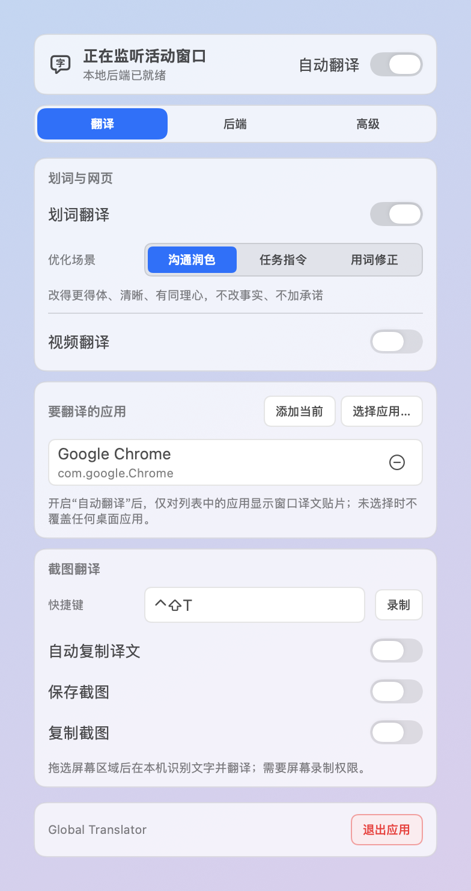
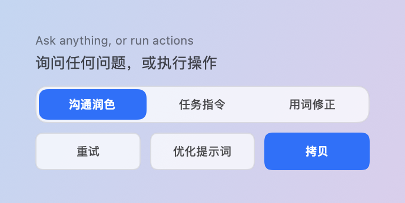
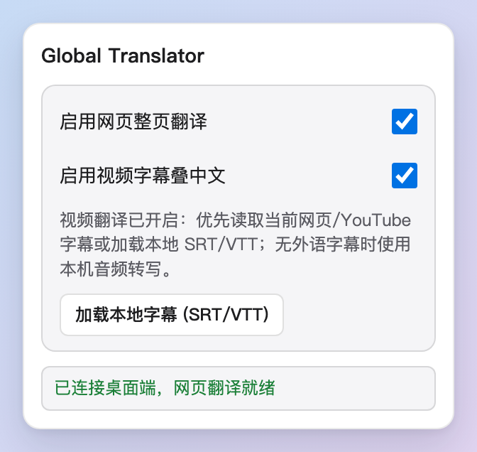

# Global Translator

[简体中文](README.md) | **English**

A privacy-first, native global translation utility for Apple Silicon Macs, shipping with a double-clickable `Global Translator.app`, menu-bar control panel, `global-translator` CLI, and a companion Chrome Manifest V3 extension (**Global Translator Bridge**).

Built for developers and everyday readers who translate across apps, codebases, screenshots, and foreign-language videos all day—without handing screen recordings, system audio, or plaintext API keys to a closed-source black box. It pairs a native macOS **Liquid Glass 3-tab UI** (`翻译` / `后端` / `高级`) with **Accessibility + on-device Apple Vision OCR**, **ScreenCaptureKit + local Whisper.cpp** audio transcription, and switchable **Local Ollama / DeepSeek Cloud** streaming backends.

## Screenshots

| Menu-Bar Settings (Liquid Glass) | Selection & Prompt Polish Popover | Chrome Extension Popup |
| :---: | :---: | :---: |
|  |  |  |

## Key Features

- **Click-Through Active Window Overlay**: Extracts text from the active window via macOS Accessibility first and automatically falls back to on-device Apple Vision OCR for custom-rendered canvases or scanned PDFs. Translations render as non-activating, mouse-passthrough solid patches and automatically hide whenever a password field, Secure Input, or screen lock is active.
- **Universal Selection Translate, Prompt Polish & Code Explainer**: Select text in any app and release the mouse button to pop up a Liquid Glass card with automatic bidirectional translation (foreign languages → Simplified Chinese, Simplified Chinese → English). Includes lossless async clipboard borrow-and-restore for apps without AX selection exposure (such as Feishu, Lark, and Electron apps), one-click draft rewriting (**Polished Communication / Task Instruction / Wording Fix**), and automatic **Code Explanation mode** across 15+ languages (translating comments/strings and explaining control flow and side effects in Chinese without mangling identifiers). See [Selection Translate Guide](docs/selection-translate.md).
- **100% On-Device OCR Screenshot Translate (`⌃⇧T` by default)**: Drag to select any screen region, run single-pass `.accurate` local Apple Vision OCR strictly in memory, and preempt background web traffic via the high-priority translation lane with live SSE streaming and both **Copy Original (`复制原文`)** and **Copy Translation (`复制译文`)** buttons—raw screenshots are never uploaded to any cloud model. Supports optional auto-copy of translated text, saving cropped PNGs locally, or copying the screenshot to the clipboard. See [Screenshot Translate Guide](docs/screenshot-translate.md).
- **In-Page Web Translation & Dual-Mode Video Subtitles**: The bundled `extension/` Chrome extension (v1.1.0) translates multi-language web pages in place while automatically skipping `translate="no"`, `.notranslate`, `aria-hidden` icon words, icon-font glyphs, and mislabeled Simplified Chinese pages (`lang="en"` / `lang="zh-TW"`), restoring original text cleanly when toggled off (see [Bridge Source Language](docs/bridge-source-language.md)). Its popup lets you toggle **Video Translate** directly (synced with the desktop app) and load local `.srt`/`.vtt` sidecar files alongside HTML5 `<video>` tracks or active YouTube captions. When a video has no foreign subtitle track, it falls back to capturing window/system audio via ScreenCaptureKit + local `whisper.cpp` transcription—never touching your microphone or interrupting playback. See [Video Translate Guide](docs/video-translate.md).
- **Dual Backend: Local Ollama & DeepSeek Cloud**: Run completely offline against a loopback Ollama server (`http://127.0.0.1:11434/v1` by default, with automatic Homebrew Ollama suspend/resume when switching backends to free unified memory—see [Ollama Lifecycle](docs/ollama-lifecycle.md)), or connect to the official DeepSeek Responses API (`deepseek-flash`). Both backends support SSE token streaming and never silently cross-fallback or replay uncertain requests.

## Privacy & Security by Design

Global translation utilities require sensitive macOS permissions (`Accessibility` and `Screen Recording`). Every layer of Global Translator is engineered so you can verify exactly what stays on your Mac:

| Area | Architectural Guarantee |
| :--- | :--- |
| **API Key Isolation** | Stored exclusively in the macOS **Keychain** (preferring the Data Protection Keychain with iCloud sync disabled when entitled, falling back only on `errSecMissingEntitlement` to the login Keychain). Keys never touch `config.json`, CLI arguments, environment variables, caches, or logs, and are sanitized against control/non-ASCII characters to prevent header injection. |
| **Zero Screenshot Uploads** | Screenshot translation runs Apple Vision OCR locally; cropped images are **never** sent to cloud or local LLMs. Window scroll/change detection retains only quantized `256×256` frames at up to 4 fps in memory for diffing—never written to disk or transmitted. Optional screenshot PNG saves use `O_EXCL\|O_NOFOLLOW` atomic writes with `0600` permissions. |
| **System Audio Stays Local** | Visual capture streams enforce `capturesAudio = false`. A dedicated ScreenCaptureKit audio stream (`captureMicrophone = false`) starts **only** when Video Translate is enabled, no subtitle track exists, and a matching browser window is present. Audio is transcribed locally by ownership/permission-verified `whisper.cpp` using `0600` scratch files deleted immediately after transcription. |
| **Zero Text Persistence** | Source text, translations, and O(1) LRU caches live strictly in process memory. Configuration (`~/Library/Application Support/GlobalTranslator/config.json`) and redacted telemetry logs (`~/Library/Logs/GlobalTranslator/`, including `cli.log`) enforce `0600` permissions and log only status codes, character counts, and latencies—never user text. |
| **Secure Input & Clipboard Safety** | Overlays, selection hooks, screenshots, bridge calls, and video ASR pause immediately when `SecureTextField`, macOS Secure Input, or screen lock is active. The `⌘C` fallback skips sensitive pasteboard types (e.g., 1Password / `ConcealedType` / `TransientType`) and runs only when existing pasteboard items can be backed up in full, restoring your original clipboard inside an uninterruptible async guard window. |
| **Local Bridge & Hardened Runtime** | The `:9233` extension bridge binds strictly to loopback `127.0.0.1` and enforces `Host` checks, `Origin` allowlists, connection/concurrency caps, token-bucket rate limiting, and `pageOrigin` cache isolation; packaged `.app` bundles enforce **Hardened Runtime** (`--options runtime`). |

## Quick Start

### 1. Requirements

- **Hardware**: Apple Silicon Mac (16 GB+ unified memory recommended, especially for local LLM inference)
- **OS & Toolchain**: macOS 27 or later, Swift 6.4 toolchain (`swift-tools-version: 6.4`)
- **Permissions**: Grant **Accessibility** and **Screen Recording** under `System Settings -> Privacy & Security` (at least one is required for core functionality; granting both enables full AX/OCR fallback, screenshot translation, and scroll detection)

### 2. Build & Install the App

Clone the repository and package `Global Translator.app` in one command:

```bash
bash scripts/package-app.sh

# Optional: if you have a local self-signed or Developer ID certificate in your Keychain
# to keep a stable cdhash across rebuilds (preserving macOS TCC grants), pass:
# CODESIGN_IDENTITY="Global Translator Dev" bash scripts/package-app.sh
```

The packaged bundle is written to `.build/desktop/Global Translator.app` (ad-hoc signed with `-` by default, unnotarized—if installing a prebuilt release zip, **right-click the app → Open** on first launch).

Copy the app into `~/Applications/` and symlink the CLI binary (ensure `~/.local/bin` is in your `PATH`):

```bash
mkdir -p ~/Applications ~/.local/bin
cp -R ".build/desktop/Global Translator.app" ~/Applications/
ln -sf "$HOME/Applications/Global Translator.app/Contents/MacOS/global-translator" ~/.local/bin/global-translator
```

Launch `Global Translator.app` from Finder, click the blue "译" icon in the Dock, or click the menu-bar item to open Settings. Closing the settings window keeps background translation active; choose "退出全局翻译" or press `⌘Q` to quit completely.

### 3. Configure Your Translation Backend

- **Option A: Local Offline Model (Zero API Cost, 100% Local)**
  1. Install and run Ollama on loopback (`127.0.0.1`, `localhost`, or `::1` only). A lightweight instruction model such as [qwen3:4b-instruct-2507-q4_K_M](https://ollama.com/library/qwen3:4b-instruct-2507-q4_K_M) with [Ollama Structured Outputs](https://docs.ollama.com/capabilities/structured-outputs) works well on 16 GB Macs.
  2. In Settings, choose **本地模型 (Local Model)**, keep `http://127.0.0.1:11434/v1`, select your model, and test the connection. See [Local Model Setup](docs/local-model-setup.md) for recommended `Modelfile` tuning.
- **Option B: DeepSeek Cloud (Fast Response, Minimal Local Memory)**
  1. Create an API key on the [DeepSeek Platform](https://api-docs.deepseek.com/) (see [Pricing](https://api-docs.deepseek.com/quick_start/pricing/); uses the official [Responses API](https://api-docs.deepseek.com/api/create-response/) pinned to `deepseek-flash`).
  2. In Settings, choose **DeepSeek 云端 (DeepSeek Cloud)**, save your API key to Keychain, and test the connection.

### 4. Load the Chrome Extension & Optional Whisper.cpp

1. Open `chrome://extensions/` in Google Chrome and enable **Developer mode**.
2. Click **Load unpacked** and select the `extension/` directory in this repository.
3. To enable live subtitle generation for uncaptioned English videos, turn on **视频翻译 (Video Translate)** in the menu-bar settings and place `whisper-cli` plus an English ggml model (`ggml-base.en.bin` or `ggml-tiny.en.bin`) in `~/Library/Application Support/GlobalTranslator/whisper/` (or install via `brew install whisper-cpp`). See [Video Translate Guide](docs/video-translate.md).

## CLI & Optional `launchd` Supervision

```bash
global-translator doctor          # Verify permissions, backend health, Keychain, and Whisper setup
global-translator start           # Start the background worker
global-translator settings        # Open the settings panel (handy if macOS clips menu-bar icons)
global-translator status          # Check running state and PID
global-translator logs --follow   # Tail redacted runtime logs
global-translator stop            # Stop the background worker
global-translator run --foreground # Run in the foreground for debugging
```

For automatic login startup or crash supervision, copy [com.maodashu.global-translator.daemon.plist](packaging/com.maodashu.global-translator.daemon.plist) (configured for `~/Applications/Global Translator.app`; if you installed into `/Applications/`, update the first `ProgramArguments` entry accordingly), replace `__HOME__` with your home directory path, place it in `~/Library/LaunchAgents/`, and load it via `launchctl bootstrap gui/$(id -u) ...`. Every CLI exit is audited in `~/Library/Logs/GlobalTranslator/cli.log`.

## Architecture & Development

The project is organized into focused SwiftPM targets alongside the Chrome extension:

| Target / Directory | Responsibility |
| :--- | :--- |
| `Sources/GlobalTranslatorCore` | Configuration, Keychain integration, HTTP transport, DeepSeek & Local OpenAI-compatible adapters, selection & code-snippet heuristics |
| `Sources/GlobalTranslatorCapture` | Active window tracking, Accessibility tree extraction, ScreenCaptureKit visual diff & dedicated system audio streams, Vision OCR, Whisper.cpp runner |
| `Sources/GlobalTranslatorEngine` | Text filtering, chunking & batching, multi-key LRU cache, debounce scheduling, circuit breaker, and stale-revision eviction |
| `Sources/GlobalTranslatorUI` | Menu-bar status item, Liquid Glass settings panel, region-selection overlay, selection popover, and click-through translation patches |
| `Sources/GlobalTranslatorRuntime` | CLI parser, single-instance lock, Unix domain socket IPC, redacted logging, and `doctor` diagnostics |
| `Sources/GlobalTranslatorApp` | App lifecycle, Carbon global hotkeys, local `:9233` browser bridge server, and dependency wiring |
| `extension/` | Chrome Manifest V3 extension (in-page DOM translation, HTML5 / SRT·VTT / YouTube caption parsing, and video subtitle overlay) |

UI specifications live in [DESIGN.md](DESIGN.md), and key architectural decisions are documented in [ADR-001](docs/decisions/001-bare-executable-status-item.md) and [ADR-002](docs/decisions/002-desktop-settings-entry.md) (note: when the macOS menu bar is crowded, ControlCenter may hide status item pixels; you can always open Settings via the Dock icon, Finder, or `global-translator settings`).

Run the test suites and build a distributable release archive locally:

```bash
# Run Swift unit tests and strict-concurrency release build
swift test -Xswiftc -warnings-as-errors
swift build -c release -Xswiftc -strict-concurrency=complete -Xswiftc -warnings-as-errors

# Run Chrome extension unit tests
node --test extension/*.test.js

# Package Global Translator.app and build dist/Global-Translator-<ver>-<arch>.zip + .sha256
# Public releases require a valid CODESIGN_IDENTITY; pass ALLOW_ADHOC=1 for local unsigned tests
bash scripts/package-app.sh
ALLOW_ADHOC=1 bash scripts/make-release.sh
```

## License & Contributing

- **License**: Released under the [MIT License](LICENSE).
- **Community & Security**: See [CONTRIBUTING.md](CONTRIBUTING.md) before opening a PR, [SECURITY.md](SECURITY.md) for vulnerability reporting, and [CHANGELOG.md](CHANGELOG.md) for release history.
